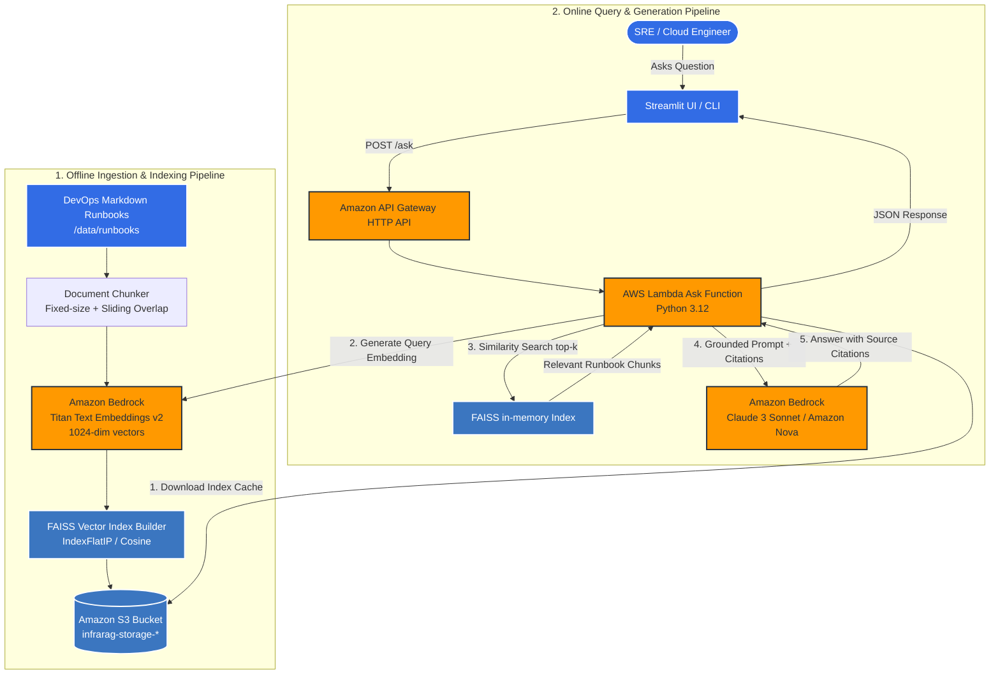

# InfraRAG: Serverless DevOps & SRE Runbook Q&A Assistant

[](https://github.com/pathak/infrarag)
[](https://www.python.org/downloads/release/python-3120/)
[](https://aws.amazon.com/bedrock/)
[](https://www.terraform.io/)
[](#cost-breakdown)

> **InfraRAG** is a lightweight, low-cost (~$5/mo) serverless Retrieval-Augmented Generation (RAG) assistant designed for DevOps, Cloud, and SRE teams. It ingests complex infrastructure runbooks (Kubernetes, Istio, Docker, AWS), embeds them using **Amazon Bedrock Titan Text v2**, indexes them with a serialized **FAISS** vector store on **Amazon S3**, and serves grounded, citation-backed answers via **AWS Lambda**, **API Gateway**, and a lightweight **Streamlit UI**.

---

## 🏗️ Architecture



---

## 💡 Why This Architecture for DevOps?

1. **Zero Idle Cost**: Traditional RAG architectures rely on always-on clusters like OpenSearch Serverless (~$70–$140/mo), Pinecone ($70/mo+), or persistent EC2/EKS pods. For internal DevOps runbooks (hundreds to thousands of pages), **FAISS serialized to S3** and loaded into an ephemeral AWS Lambda memory yields sub-second retrieval at virtually **$0/month when idle**.
2. **Strict Groundedness**: Incident response requires absolute truth. If a runbook does not contain the answer, InfraRAG strictly answers *"I don't know based on the provided runbooks"* rather than hallucinating dangerous `kubectl` or `istioctl` remediation commands.
3. **Traceability & Citations**: Every generated response includes the exact runbook filename, section header, and chunk ID, allowing on-call engineers to verify the command before executing it.
4. **AWS Native & Sovereign**: Runs entirely within your AWS VPC / account in `ap-south-1` using Amazon Bedrock with no external third-party API dependencies (OpenAI/Anthropic direct APIs).

---

## 💰 Cost Breakdown

| AWS Service | Usage / Tier | Estimated Monthly Cost |
| :--- | :--- | :--- |
| **Amazon Bedrock (Titan v2)** | Ingestion (100 runbooks) + 1,000 queries/mo | ~$0.02 |
| **Amazon Bedrock (Nova / Claude 3)** | ~1,000 queries @ ~500 input / 250 output tokens | ~$0.30 - $0.75 |
| **AWS Lambda** | 1,000 invocations (1024MB RAM, ~800ms) | Free tier ($0.00) |
| **Amazon S3** | < 100 MB storage + GET/PUT requests | ~$0.01 |
| **Amazon API Gateway** | HTTP API (1,000 requests) | Free tier ($0.00) |
| **Amazon CloudWatch** | Structured logs (< 1GB ingested) | Free tier ($0.00) |
| **Total Estimated Cost** | **Active Production Dev/Ops Assistant** | **~$0.50 – $1.20 / month** |

*(Keeps total monthly spend safely below the $5.00 hard constraint).*

---

## 📂 Project Structure

```
.
├── .github/
│   └── workflows/
│       └── ci.yml               # CI: ruff lint, pytest, terraform validate
├── data/
│   └── runbooks/                # Real-world K8s, Istio, Docker runbooks
├── src/
│   ├── __init__.py
│   ├── config.py                # Pydantic v2 settings (AWS region, models, top-k)
│   ├── chunker.py               # Markdown-aware sliding-window chunker
│   ├── embeddings.py            # Amazon Bedrock Titan Text v2 wrapper
│   ├── vector_store.py          # Abstract vector store interface + FAISS S3 implementation
│   ├── retriever.py             # Top-k semantic retriever with metadata filtering
│   ├── generator.py             # Bedrock LLM generation with strict citation prompt
│   ├── chain.py                 # RAG orchestrator pipeline
│   └── lambda_handlers/         # AWS Lambda entrypoints
│       ├── ingest.py            # /ingest handler
│       └── ask.py               # /ask handler
├── terraform/                   # Infrastructure as Code (ap-south-1)
│   ├── main.tf                  # S3, Lambda, API Gateway, IAM
│   ├── variables.tf
│   ├── outputs.tf
│   └── versions.tf
├── tests/
│   ├── test_chunker.py          # Unit tests for chunking logic
│   ├── test_vector_store.py     # Unit tests for FAISS vector search
│   └── test_chain.py            # Unit tests for RAG pipeline & citations
├── evaluation/
│   ├── golden_dataset.json      # 15 golden Q&A pairs for benchmark
│   └── evaluate.py              # Evaluates hit-rate and faithfulness
├── ui/
│   └── app.py                   # Minimal Streamlit UI
├── requirements.txt             # Pinned runtime dependencies
├── requirements-dev.txt         # Testing and development dependencies
├── learn.md                     # Mandatory learning log & interview notes
└── README.md
```

---

## 🚀 Quickstart (Local Prototype)

### 1. Prerequisites
- Python 3.12+
- AWS CLI configured with credentials (`aws configure`) having access to Amazon Bedrock in `ap-south-1` (or `us-east-1`).

### 2. Setup Virtual Environment
```bash
python3.12 -m venv .venv
source .venv/bin/activate
pip install -r requirements-dev.txt
```

### 3. Run Tests
```bash
pytest -v
```

---

## 🧑‍💻 Interview Highlights
- **Why FAISS on S3 over OpenSearch/Pinecone?** Cost efficiency and simplicity. S3 provides 99.999999999% durability; Lambda caches the binary index in `/tmp` across warm invocations.
- **How is Hallucination prevented?** Few-shot in-context system prompt enforcing that answers must directly cite context chunk IDs and return *"I don't know based on the provided runbooks"* when confidence is low.
- **How are embeddings sized?** Titan Text Embeddings v2 with 1024 dimensions normalized to unit length, enabling fast inner-product (`IndexFlatIP`) distance calculations equivalent to cosine similarity.
