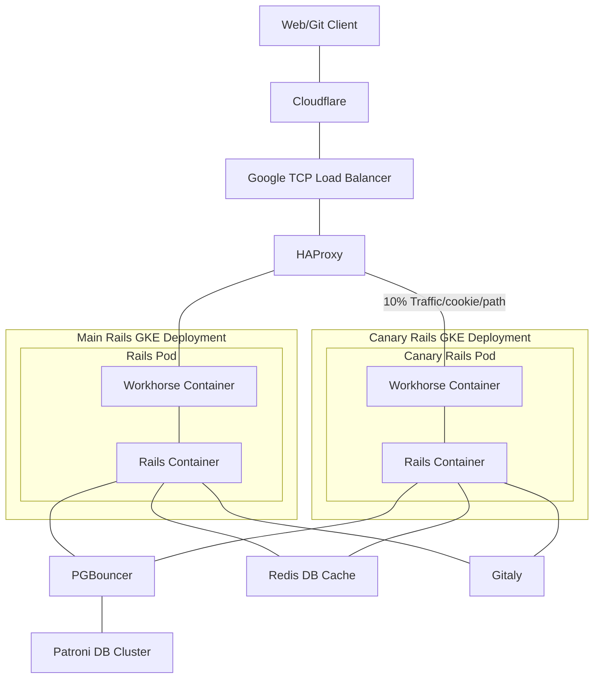

# Session: Application architecture

This is a synchronous session that covers the foundational architecture of
GitLab.com.

## Agenda

- [Architecture diagram](https://handbook.gitlab.com/handbook/engineering/infrastructure-platforms/production/architecture/)
- GCP console overview of VMs
- Life of a request: web ([tutorial](../tutorials/overview_life_of_a_web_request.md))
  - `Cloudflare` => `HAProxy` (routing to webservice api/git/web) => `web: Workhorse` => `web: rails` => Databases (Postgres, Redis, `Gitaly`, GCS)
- Life of a request: git ([tutorial](../tutorials/overview_life_of_a_git_request.md))
  - https: `Cloudflare` => `HAProxy` => `git: Workhorse` (=> `git: rails` for authn) => `Gitaly`
  - ssh: `Cloudflare` => `HAProxy` => `gitlab-shell` (=> `git: rails` for authn) => `Gitaly`
- Exploration of hosts over SSH
  - Looking at running processes, discovering service configuration

## Resources

- Architecture diagrams
  - Production GitLab.com environment diagrams: <https://handbook.gitlab.com/handbook/engineering/infrastructure-platforms/production/architecture/>
  - Application component list with descriptions and links: <https://docs.gitlab.com/development/architecture/#components>
  - Recorded session presented by Andrew Newdigate at Jan 2021: <https://www.youtube.com/watch?v=P3NhrEoSkeI>
    - this video is private, hence use the Unfiltered Youtube account -
<https://handbook.gitlab.com/handbook/marketing/marketing-operations/youtube/#unable-to-view-a-video-on-youtube>

- Chef
  - GitLab-specific: Laptop setup, cookbook change workflow, secrets management, one-liners: <https://gitlab.com/gitlab-com/gl-infra/chef-repo#getting-started>
  - Generic Chef documentation:
    - Chef Overview (use this as a glossary of Chef vocabulary): <https://docs.chef.io/overview/>
    - Chef Resource reference (list of built-in resource objects, e.g. `file`, `apt_package`): <https://docs.chef.io/resources/>
    - Chef Node Attributes (data for use in recipes, provided to chef-client about the current node's present or desired state): <https://docs.chef.io/attributes/>
- Terraform
  - Note: We are using Terraform version 0.12.x in all GitLab's environments.  The TF docs often mention 0.12 as a major version boundary, and you can ignore caveats about behavior differences older TF versions.
  - GitLab-specific: How to use terraform for managing GitLab.com resources: <https://ops.gitlab.net/gitlab-com/gl-infra/config-mgmt/-/blob/master/README.md>
  - Video demo of creating staging environment: <https://drive.google.com/open?id=0BzamLYNnSQa_cjN5NGtaRnpyRXc>
  - Generic Terraform documentation:
    - Terraform CLI and config language docs: <https://developer.hashicorp.com/terraform/cli>
    - Terraform Glossary: <https://developer.hashicorp.com/terraform/docs/glossary>
    - GCP-specific Terraform Provider: <https://registry.terraform.io/providers/hashicorp/google/latest/docs>
- Runbooks for GitLab.com: <https://gitlab.com/gitlab-com/runbooks/-/tree/master/>
  - This git repo contains much more than just "runbooks".
  - It is the main place where we collect internal documentation and advice to ourselves for working with our infrastructure components and services.
  - `/docs` sub-directory contain more up-to-date Runbooks than the root directory in this Repo.
  - It also composes metrics, alerts, and dashboards for our services using jsonnet.
  - We should probably record a guided tour of this repo.  Or just commit to giving a tour in a pairing session.

## Walkthrough Script

This walk-through covers GitLab.com currently.
Dedicated, Cells, and Self-Hosted instances are not covered.
There are other services that are part of the GitLab.com site that may not be covered by this walk-through.
Services like registry.gitlab.com, KAS, Web-Pages, etc.

### Global Traffic Ingress and Firewall

GitLab.com uses Cloudflare for DNS, WAF, and Edge Workers.
Requests from GitLab.com users, whether via http, https or ssh, will enter Cloudflare's edge network and pass through Spectrum.
Spectrum allows the `gitlab.com` record to proxy more than just ports 80 and 443, allowing the protecting of port 22 (SSH) as well.
For port 443, the SSL termination is made in Cloudflare.
Port 22 is a TCP proxy and the SSL termination is made at the application.
Page rules, advanced rate limits, and custom security rules are leveraged to protect GitLab.com resources from abuse.

### Cloud Provider Ingress

The origin for Cloudflare proxying of services are regional (us-east1) TCP load balancers.
These load balancers perform no action on the traffic.
They simply distribute the TCP traffic to backend HAProxy servers.

### HAProxy

In the us-east1 region of Google Cloud, there are several groups of HAProxy servers.
Each set of HAProxy servers is spread across three availability zones to minimize the impact of a zonal outage.
HAProxy is where traffic is routed to a backend service.
For example, HTTPS requests that start with `/api` would be routed to an API service.
Additionally, some traffic is routed to a Canary service.
What traffic is routed to a Canary service is based on a cookie, a destination project, or random percentage.
By default, HAProxy will route traffic to a backend in the same zone, using other zones as failover backends.
Some services, like git over SSH, are routed by HAProxy as TCP requests to the git shell service.

### GKE Services

There are four GKE clusters for GitLab.com's primary services.
One regional and three zonal clusters.
The regional cluster hosts Canary services and Sidekiq workers.
The zonal clusters host web, api, git, websocket, and other container based services.

#### Web Service Example

Let's look at the GitLab web service in GKE as an example of traffic through GKE.
Services like the rails web service are made up of pods, and each pod contains a rails container and a workhorse container.
Workhorse is the container that accepts direct connections from the ingress controller in GKE for web traffic.
Workhorse serves as a proxy for several services such as rails, Gitaly, and object storage objects.
The rails container is where the GitLab application code operates to serve up the web based application for GitLab users.

The rails application will reach out to several backend servers such as Redis, Gitaly, Databases, and object stores.

### Gitaly

Each GitLab project has a corresponding Gitaly repository and the database serves as the directory for which Gitaly repository belongs to which GitLab project.
A Gitaly server is hosted on a Google Cloud virtual machine and is a single point of failure for the repositories on that VM.
Rails, workhorse, and git-shell services will contact Gitaly to fulfill git requests.

### Patroni Clusters and PGBouncer

GitLab.com contains three main PostgreSQL clusters: main, sec, and ci.
There are other databases for other services.

Every database cluster member is a virtual machine that has an on-board set of PGBouncer services and a PostgreSQL services, which is managed by Patroni.
Writes for each database are made through a cluster of three PGBouncer VM servers that sit in front of the PostgreSQL cluster leader.
Read requests are directed to the on-board PGBouncer services on the read-only replica members of the database cluster.

